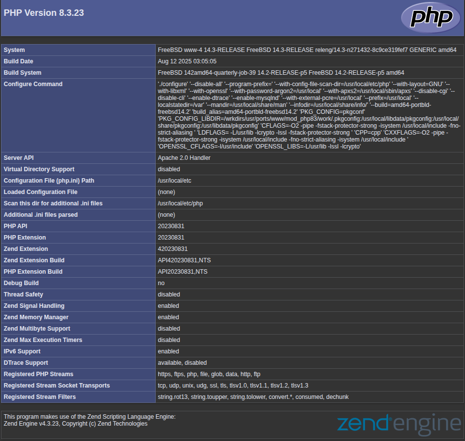

.. _example_422:

422 Role vbotka.freebsd.apache PHP
----------------------------------

.. contents::
   :local:
   :depth: 1

.. index::
   single: Apache PHP; Example 422
   single: mod_php; Example 422
   single: Apache HTTP Server; Example 422
   single: role vbotka.freebsd.apache; Example 422
   single: vbotka.freebsd.apache; Example 422

Use case
^^^^^^^^

Use the role `vbotka.freebsd.apache`_ to configure PHP in `Apache HTTP Server`_.

Tree
^^^^

::

  shell> tree .
  .
  ├── ansible.cfg
  ├── files
  │   └── info.php
  ├── hosts
  │   ├── 06_iocage2.yml
  │   └── 99_constructed.yml
  ├── host_vars
  │   ├── iocage_06
  │   │   └── apache.yml
  │   └── www_4
  │       └── apache.yml
  ├── iocage.ini
  ├── pb-apache.yml
  └── pb-data.yml

Synopsis
^^^^^^^^

* On the managed nodes:

  * In the playbook :ref:`ug_pb-iocage-ansible-clients`, create jails
    from the template ``ansible-apache``.

* On the created jails:

  * In the playbook ``pb-data.yml``, create the file ``data/info.php``.

  * In the playbook ``pb-apache.yml``, configure and start `Apache HTTP Server`_.

Requirements
^^^^^^^^^^^^

* Role `vbotka.freebsd.apache`_
* Template ``ansible-apache`` created in :ref:`example_209`

Notes
^^^^^

* TBD.

.. note::

   | `vbotka.freebsd.apache`_ is the role **apache** in the `collection vbotka.freebsd`_.
   | `vbotka.freebsd_apache`_ is the role **freebsd_apache** in the namespace `vbotka`_.

.. seealso::

   * `FreeBSD Handbook 32.9. Apache HTTP Server`_
   * `FreeBSD Handbook 32.9.3.3. mod_php`_
   * `Apache HTTP Server`_
   * `PHP manual Apache PHP`_
   * `PHP manual phpinfo`_
   * `man 8 iocage`_

ansible.cfg
^^^^^^^^^^^

.. literalinclude:: ansible.cfg
   :language: ini

Inventory iocage.ini
^^^^^^^^^^^^^^^^^^^^

.. literalinclude:: iocage.ini
   :language: ini

hosts
^^^^^

.. literalinclude:: hosts/06_iocage2.yml
   :language: yaml+jinja
   :caption:

.. literalinclude:: hosts/99_constructed.yml
   :language: yaml+jinja
   :caption:

host_vars
^^^^^^^^^

.. literalinclude:: host_vars/iocage_06/apache.yml
   :language: yaml+jinja
   :caption:

.. literalinclude:: host_vars/www_4/apache.yml
   :language: yaml+jinja
   :caption:

Create and start jails
^^^^^^^^^^^^^^^^^^^^^^

.. code-block:: console

   (env) > ansible-playbook -i iocage.ini \
                            -t clone -e clone=true \
                            vbotka.freebsd.pb_iocage_ansible_clients.yml

.. literalinclude:: out/out-01.txt
   :language: yaml+jinja
   :force:

Graph
^^^^^

.. literalinclude:: out/out-02.txt
   :language: console
   :caption: (env) > ansible-inventory -i hosts --graph

Jails
^^^^^

.. literalinclude:: out/out-03.txt
   :language: console
   :caption: [iocage_06]# iocage list -l

Playbook pb-data.yml
^^^^^^^^^^^^^^^^^^^^

.. literalinclude:: pb-data.yml
   :language: yaml+jinja

Playbook output - Create data/info.php
^^^^^^^^^^^^^^^^^^^^^^^^^^^^^^^^^^^^^^

.. code-block:: console

   (env) > ansible-playbook -i hosts pb-data.yml

.. literalinclude:: out/out-04.txt
   :language: yaml+jinja
   :force:

Playbook pb-apache.yml
^^^^^^^^^^^^^^^^^^^^^^

.. literalinclude:: pb-apache.yml
   :language: yaml+jinja

Playbook output - Configure and start Apache
^^^^^^^^^^^^^^^^^^^^^^^^^^^^^^^^^^^^^^^^^^^^

.. code-block:: console

   (env) > ansible-playbook -i hosts pb-apache.yml

.. literalinclude:: out/out-05.txt
   :language: yaml+jinja
   :force:

Results
^^^^^^^

* Test the configuration:

  .. literalinclude:: out/out-06.txt
     :language: console
     :caption: [iocage_06]# iocage exec www-4 service apache24 configtest

* Test that the server is running:

  .. literalinclude:: out/out-07.txt
     :language: console
     :caption: [iocage_06]# iocage exec www-4 service apache24 status

* In a browser, open the page ``http://www-4/info.php``. If the URL
  resolves, the content should look similar to the screenshot below.

